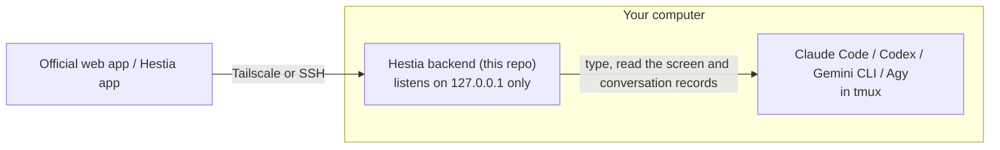

# Hestia

[中文](README.md) ｜ English

Drive the AI CLIs running in tmux on your own computer from your phone or another computer: Claude Code, Codex, Gemini CLI, Agy.

This repo is Hestia's **backend**: it runs on your own computer, and the frontend (the Hestia app) drives that computer's tmux through it.

## What it does

An AI CLI's work often runs for minutes at a time, and it stops along the way to wait for you to confirm or answer; when the quota runs out, someone has to be there too. Once you step away from the computer, you only find out where it got stuck when you come back. Hestia lets you:

- **Move between phone and computer without a break**: the CLI keeps running in your computer's tmux, and the phone, the web app and the desktop are just different ways to drive the same session; back at the computer, `tmux -L hestia attach` (or `hestia open`) shows the same screen. On a desktop there's a two-column layout, with the terminal split alongside if you like.
- **Drive the CLI like a chat**: the CLI's own conversation records become a chat view, and when it asks to confirm a permission you answer right there. The live terminal is there when you need it, as a helper.
- **Many LLMs in one place**: Claude Code, Codex, Gemini CLI and Agy all work. Each account becomes a launch profile; pick one when you start a session, and see right beside it how much quota that account has left.
- **No need to stand by when the quota runs out**: when the CLI hits its usage limit, it can carry on by itself once the limit resets, or hand over to another account or another LLM and continue in the same tmux (Claude Code and Codex for now).
- **Know when to come back**: each session shows "replying / ready / needs you", and you get a push notification on the web, iOS or Android when a reply finishes or the CLI waits for you. Turn on conversation recaps to see at a glance what a long conversation did.
- **Connect only to your own computer**: the frontend comes with no backend. Everyone installs the backend on their own machine and connects to it from the frontend by scanning a QR code; the connection goes only through Tailscale or the Hestia app's built-in SSH, so only your own devices can reach it.

**Design principle**: Hestia only drives the official CLIs: it types into them, reads their screen and reads the conversation records they write themselves. It doesn't read your tokens or account credentials, and doesn't call a vendor's private API.

## Install

Requires Linux (a systemd user service), tmux and at least one AI CLI. No root needed. You don't have to install Node.js: if the system's version is too old, the installer downloads one for your user alone.

> **The backend must not be exposed to the internet.** A Hestia backend amounts to full control of this machine (it can run any command as you). Use it only through Tailscale or the Hestia app's SSH connection; don't expose the backend to the internet by any other means (a reverse proxy, a tunnel service, a port forward on your router, a changed listen address): then the only thing protecting it is the username and password.

```bash
curl -fsSL https://github.com/maderaojen/tessera-hestia/releases/latest/download/install.sh | sh -s -- --tailscale
```

It downloads the latest backend bundle from [Releases](https://github.com/maderaojen/tessera-hestia/releases), first verifies the release signature with the public key in the installer, then its SHA-256 (to read the installer and check the key's fingerprint before running it, see [release signatures](docs/guides/release-signing.en.md)), and puts it in `~/.local/share/hestia/app/`; then asks for a sign-in account and password and starts the backend as a systemd user service; installs Tailscale for you when needed and prints the sign-in address; and finally prints a **QR code**. Once the phone has the Tailscale app installed and signed in to the same account, tap "Scan QR code" under "Add host" in the Hestia app (or scan it with the camera), check the host address on screen, and the host is added and signed in (a one-time pairing code, valid for 3 minutes). To add another phone later, run `hestia pair`.

**Upgrading**: run the same line again. Settings and data both live in `~/.config/madera/hestia/`, and are kept, and conversations in tmux are not affected. For a specific version, put `HESTIA_VERSION=vX.Y.Z` before `sh`.

You can also install from source (built locally):

```bash
git clone https://github.com/maderaojen/tessera-hestia.git
tessera-hestia/api/scripts/install.sh --tailscale
```

Full instructions, options, upgrading and uninstalling: [`docs/guides/install.en.md`](docs/guides/install.en.md).

## Frontend

- **Hestia app** (iOS / Android, in development): besides Tailscale, it can also connect over its built-in SSH, with no Tailscale to install.

The frontend comes with no backend; each host is reached directly at its own address. The frontend's source isn't public for now; by default the backend only accepts the Hestia app (CORS), and if you host a web frontend of your own, set `--cors-origins` when installing.

## Architecture



Ways to connect, authentication, notifications, the backend's modules and the state directory: [`docs/reference/architecture.en.md`](docs/reference/architecture.en.md); the API contract: [`docs/reference/api-contract-v1.en.md`](docs/reference/api-contract-v1.en.md).

Development: `cd api && npm ci && npm test`.

## Security

The backend can open tmux, browse files and start AI CLIs: **whoever has the account and password has your user's shell on this computer.**

- The backend listens on `127.0.0.1` only, and refuses to start on any other listen address.
- Use it only through Tailscale (`tailscale serve`, never Funnel) or the Hestia app's SSH connection. Don't expose the backend to the internet by any other means (a reverse proxy, a tunnel service, a port forward on your router, a changed listen address): then the only thing protecting it is the username and password.
- The SSH connection relies on your own sshd: let it allow key authentication only.

Details: "Security" in [`docs/guides/install.en.md`](docs/guides/install.en.md).

## License

[Apache License 2.0](LICENSE).

Product terms follow [Product terminology](docs/reference/terminology.en.md).
