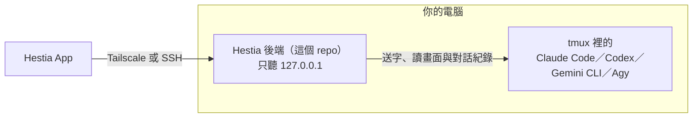

# Hestia

介面層級為「專案 → 工作階段 → 對話」，中英文定義見 [產品名詞](docs/reference/terminology.md)。

中文 ｜ [English](README.en.md)

用手機或電腦，操作你自己電腦上、跑在 tmux 裡的 AI CLI：Claude Code、Codex、Gemini CLI、Agy。

這個 repo 是 Hestia 的**後端**：裝在你自己的電腦上，前端（Hestia App）透過它操作那台電腦上的 tmux。

## 能做什麼

AI CLI 的工作常常一跑就是好幾分鐘，中途還會停下來等你確認或回答；額度用完了也得有人在場處理。人一離開電腦，就只能等回來才知道它卡在哪裡。Hestia 讓你：

- **手機和電腦無縫接手**：CLI 一直跑在你電腦的 tmux 裡，手機、網頁、桌機都只是同一個工作階段的不同操作介面；回到電腦前，`tmux -L hestia attach`（或 `hestia open`）就是同一個畫面。桌機版有兩欄版面，也能把終端機分割在旁邊。
- **像聊天一樣操作 CLI**：把 CLI 自己的對話紀錄整理成聊天畫面，CLI 要你確認權限時直接在畫面上回覆。需要時再看即時的終端機，終端機只是輔助。
- **一個地方用多個 LLM**：Claude Code、Codex、Gemini CLI、Agy 都能用。每個帳號設成一個 launch profile，開工作階段時選要用哪一個，旁邊直接看到這個帳號還剩多少額度。
- **額度用完不用守著**：CLI 撞到額度上限時，可以等重置後自動繼續，或交接給另一個帳號、另一個 LLM，在同一個 tmux 接著做（目前支援 Claude Code 與 Codex）。
- **知道什麼時候該回來**：每個工作階段顯示「回覆中／可輸入／需要處理」，回覆完成或等你確認時推播到網頁、iOS 或 Android。也可以開啟對話摘要，回頭快速看一段長對話做了什麼。
- **只連你自己的電腦**：前端不內建任何後端。每個人在自己的機器上安裝後端，掃 QR code 就能從前端連過去；連線只走 Tailscale 或 Hestia App 內建的 SSH，只有你自己的裝置連得到。

**設計原則**：Hestia 只遙控官方 CLI，送字、讀畫面、讀 CLI 自己寫的對話紀錄；不讀你的 token 或帳號憑證，也不直接呼叫廠商的私有 API。

## 安裝

需要 Linux（systemd 使用者服務）、tmux，以及至少一個 AI CLI。不需要 root。Node.js 不必自己裝：系統的版本不夠新時，安裝程式會替你下載一份只給這個使用者用的。

> **後端不能公開到網際網路。** Hestia 後端等同這台機器的完整操作權限（能以你的身分執行任何指令）。只透過 Tailscale 或 Hestia App 的 SSH 連線使用；不要用反向代理、tunnel 服務、路由器埠轉發或改監聽位址等任何方式把後端公開到網際網路——那樣唯一的保護只剩帳號密碼。

先依[發布簽章配置](docs/guides/release-signing.md)獨立核對公鑰與安裝器。新版安裝器需要已簽章版本及本機可信任公鑰；首次正式金鑰配置須由維護者完成。

```bash
HESTIA_RELEASE_PUBLIC_KEY=/path/to/trusted-release-public.pem sh /path/to/trusted-install.sh --tailscale
```

它會從 [Releases](https://github.com/maderaojen/tessera-hestia/releases) 下載最新的後端版本包並先驗證發布簽章再驗證 SHA-256，放到 `~/.local/share/hestia/app/`，接著詢問登入帳號密碼、以 systemd 使用者服務啟動後端；需要時替你安裝 Tailscale 並印出登入網址；最後印出一個 **QR code**。手機裝好 Tailscale App 並登入同一個帳號後，在 Hestia App 的「新增主機」按「掃描 QR code」（或用相機掃），確認畫面上的主機網址後，就會新增這台主機並直接登入（一次性配對碼，3 分鐘內有效）。之後要加新手機，執行 `hestia pair`。

**升級**：重跑同一行指令。設定與資料都在 `~/.config/madera/hestia/`，都會保留，tmux 裡的對話不受影響。要裝指定版本，在 `sh` 前面加 `HESTIA_VERSION=vX.Y.Z`。

也可以從原始碼安裝（會在本機建置）：

```bash
git clone https://github.com/maderaojen/tessera-hestia.git
tessera-hestia/api/scripts/install.sh --tailscale
```

完整說明、參數、升級與移除見 [`docs/guides/install.md`](docs/guides/install.md)。

## 前端

- **Hestia App**（iOS／Android，開發中）：除了 Tailscale，也能用 App 內建的 SSH 連線，不用另外裝 Tailscale。

前端不內建任何後端，每台主機都用自己的網址直連。前端原始碼目前沒有公開；後端預設只接受 Hestia App 的來源（CORS），自己架網頁前端的話，安裝時用 `--cors-origins` 設定。

## 架構



連線方式、認證、推播、後端模組與狀態資料夾，見 [`docs/reference/architecture.md`](docs/reference/architecture.md)；API 合約見 [`docs/reference/api-contract-v1.md`](docs/reference/api-contract-v1.md)。

開發：`cd api && npm ci && npm test`。

## 安全須知

後端可以開 tmux、瀏覽檔案、啟動 AI CLI，**拿到帳密就等於拿到這台電腦上你這個使用者的 shell**。

- 後端只聽 `127.0.0.1`，設成其他監聽位址時會拒絕啟動。
- 只透過 Tailscale（`tailscale serve`，不要用 Funnel）或 Hestia App 的 SSH 連線使用。不要用反向代理、tunnel 服務、路由器埠轉發或改監聽位址等任何方式把後端公開到網際網路——那樣唯一的保護只剩帳號密碼。
- SSH 連線靠的是你自己的 sshd：讓它只允許金鑰登入。

細節見 [`docs/guides/install.md`](docs/guides/install.md) 的「安全須知」。

## 授權

[Apache License 2.0](LICENSE)。
