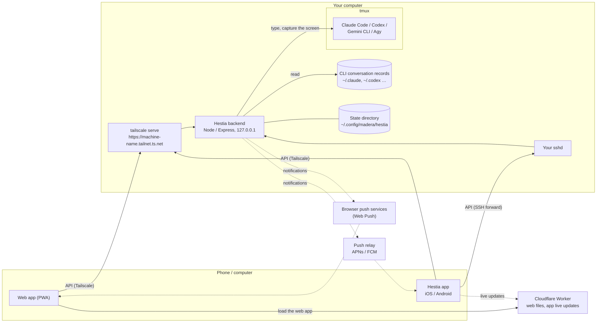
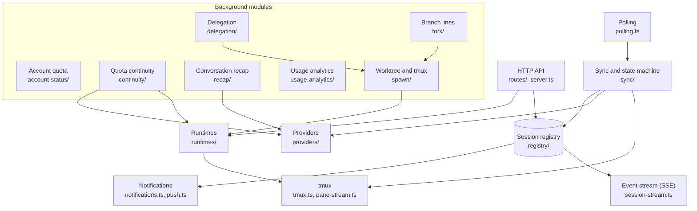

# Architecture

- Updated: 2026-10-20
- 中文: [architecture.md](architecture.md)

For anyone who wants to understand or change Hestia's backend: where each part runs, how they connect, and which modules the backend has. The feature overview is in the README; to install, see the [install guide](../guides/install.en.md).

## Design principles

- **Only drive the official CLIs.** Claude Code, Codex, Gemini CLI and Agy run in tmux as usual; the backend does just three things: types into tmux, captures the screen, and reads the conversation records the CLI writes to disk itself. It doesn't read tokens or credentials (the one exception: from Claude's credentials file it reads only when the login expires, see [account status](account-status.en.md)), and doesn't call a vendor's private API. Background work (conversation recaps) also goes through the CLI's official non-interactive mode (`claude -p`, `codex exec`).
- **The backend lives on your own computer only.** It listens on `127.0.0.1` alone; other devices come in through Tailscale or the app's SSH connection. The frontend comes with no backend.
- **tmux is the source of truth.** Restarting or upgrading the backend doesn't interrupt a CLI; back at the computer, `tmux -L hestia attach` (or `hestia open`) shows the same screen. Hestia opens its sessions on its own tmux server (`-L hestia`, named after the session prefix), apart from the tmux you use day to day: `tmux kill-server` in an ordinary terminal doesn't end them, and two installs on one machine each use their own. The server lives outside the backend's service: on Linux it is started with `systemd-run --user --scope`; on macOS tmux runs in a session of its own and the LaunchAgent sets `AbandonProcessGroup`. Restarting or stopping the backend never takes it along.
- **Personal use.** One host serves one person; one frontend can connect to several hosts.

## Parts and connections



| Part | Where | What it does |
|---|---|---|
| Backend `api/` | Your computer, as a user service (systemd on Linux and WSL, a launchd LaunchAgent on macOS) | Manages tmux sessions, sends input to the CLIs, turns conversation records into messages, streams the live terminal, sends notifications, and runs the background work listed under "Backend modules" |
| tmux and the AI CLIs | The same computer | What actually runs. The backend only drives them |
| Web app and app | Phone, computer | The same Vue 3 frontend; the app wraps it for iOS / Android with Capacitor. Each host is reached at its own address |
| Cloudflare Worker | Operator | Serves only the web files and the app's live-update bundles; it doesn't forward API calls |
| Push relay | Operator | For the app only: passes the backend's notifications on to APNs / FCM |

### Ways to connect

There are two, and no other way is supported:

- **Tailscale**: `tailscale serve` provides a `ts.net` address with an HTTPS certificate and forwards to the backend on `127.0.0.1`; only devices in your own tailnet can reach it. Works for both the web app and the app. The installer can set it up without root.
- **SSH (app only)**: the app signs in to your own sshd with a key and forwards to `127.0.0.1`. No Tailscale needed; a web page can't do this.

Details in [multi-host design](multi-host-design.en.md).

### Authentication

- **Sign-in**: a username and password, or the QR code `hestia pair` prints (a one-time pairing code, valid for 3 minutes), exchanged for a bearer token that is only ever sent in a header.
- **Live streams**: EventSource can't send headers, so they use a ticket that lasts 60 seconds and works once.
- **Images**: a short-lived media token that can only read uploads.
- **Local tool token**: written to the state directory when the backend starts, for the `hestia` command on this computer (including CLIs inside tmux). Actions the user must decide on themselves, such as changing quota continuity settings, take only a sign-in token, not this one.
- **CORS**: by default only the Hestia app is accepted; for a web frontend of your own, set `--cors-origins` when installing.

### Notifications

- **Web app**: Web Push. The VAPID key pair is made on first use and kept in the state directory, readable by this user only.
- **App**: iOS / Android can't take Web Push. When subscribing, the app gives the backend the relay's address and an opaque credential, which the backend posts back with each notification; the backend knows no relay of its own.

### Compatibility

When a frontend adds a host it reads `GET /meta`: it is used only when the API contract version (`contractVersion`) matches, and `capabilities` decide which features are shown. The contract is in [API contract v1](api-contract-v1.en.md).

## Backend modules



| Module | Where | What it does |
|---|---|---|
| HTTP API | `server.ts`, `routes/` | Express, every path under `/api`; everything but sign-in and the health check (`/api/health`) requires authentication first |
| Shared contract | `contract/` | Types, error codes and the content of `/meta`, shared by backend and frontend |
| Session registry | `registry/`, `registry.json` | Each tmux session, the project it belongs to, and every conversation that has run in it in turn |
| tmux | `tmux.ts`, `pane-stream.ts` | Opens and closes tmux, types into it, captures the screen, streams the live terminal; each session's commands go to the tmux server it is on (`registry.tmuxSocketFor`) |
| Runtimes | `runtimes/` | How each CLI is launched, resumed, switched to another model and `/clear`ed, and how its startup prompts (such as trusting a folder) are answered |
| Providers | `providers/` | Reads each CLI's own conversation records (JSONL for Claude and Codex, SQLite for Agy), and tells whether it hit its usage limit |
| Polling, sync and state machine | `polling.ts`, `sync/` | On a timer, compares each session's screen, processes and conversation records to tell "replying / ready / needs you", and confirms a sent message actually arrived. The state machine's design is in [ADR 0007](../decisions/0007-session-state-machine.en.md) and [ADR 0010](../decisions/0010-runtime-transition-convergence.en.md) |
| Event stream | `session-stream.ts`, `routes/events.ts` | Pushes session changes to frontends over SSE |
| Notifications | `notifications.ts`, `push.ts` | Notifies when a reply finishes or the CLI waits for your confirmation |
| Launch profiles | `launch-profiles.ts` | A "CLI + account + options" combination, used to start sessions and to switch accounts on a handoff |
| Account quota | `account-status/` | Checks each account's 5-hour / 7-day quota every 15 minutes and writes a snapshot; frontends only read the snapshot. See [account status](account-status.en.md) |
| Quota continuity | `continuity/` | When the CLI hits its usage limit, records the reset time and carries on by itself when it comes; or hands over to the next profile in a chain (same tmux, a new conversation, starting only once the CLI taking over has confirmed what it understood). Supports Claude Code and Codex for now |
| Conversation recap | `recap/` | Off by default. Once on, each conversation is summarised in batches while idle, by the CLI's non-interactive mode |
| Usage analytics | `usage-analytics/` | Scans the CLIs' records every minute and keeps token usage in a local SQLite database |
| Delegation | `delegation/` | Early: hands a piece of work to another profile, run in a new tmux and git worktree, and accepted by the user once delivered |
| Branch lines | `fork/` | Early: opens another line from a conversation, carrying its memory into a new tmux and git worktree to run at the same time (the CLI's native fork for the same profile, a brief otherwise); it reports nothing back and delivers nothing, and only where it came from is recorded |
| Worktree and tmux | `spawn/` | The core delegation and branch lines share: planning and making the worktree, the tmux, starting the CLI, sending the brief and reading it back, and on closing, checking whether the branch is merged |
| Files and Git | `fs-browser.ts`, `repo-*.ts`, `git/` | Browses project files, Git status, history and diffs |
| Notes, projects, tags | `notes/`, `notes-store.ts`, `project-store.ts`, `tag-index.ts` | Notes and their images, the project list, the tag index |
| Optional modules | `module-host/`, `api/modules/*` | Loads the optional modules under `api/modules/` at startup: mounts their routes (behind sign-in like the rest) and lists them in `/meta`'s `modules` and `capabilities`. With no module it starts just the same; the public release has none |
| The `hestia` command | `cli/` | `hestia pair` (pair a new device), `hestia conversation show` (prints a conversation as markdown, saving nothing) and more; talks to the backend on this computer |

## State directory

By default `~/.config/madera/hestia/` (under the Tessera family's `MADERA_HOME` when that is set, otherwise following `XDG_CONFIG_HOME` when it is set). Kept across upgrades and reinstalls. The main contents:

| File | Contents |
|---|---|
| `registry.json` | Sessions and their conversations |
| `session-events.jsonl` | What happened to each tmux: who closed, deleted or relaunched it, and when a tmux was found gone (one line per event; moved to `.1` past 2 MB) |
| `projects.json`, `notes/`, `uploads/` | Projects, notes, uploaded files |
| `launch-profiles.json` | Launch profiles |
| `session-tokens.json`, `cli-token` | Sign-in tokens, the local tool token |
| `vapid.json`, `push-subscriptions.json` | The Web Push key pair, each device's push subscription |
| `account-status.json` | The account quota snapshot |
| `continuity.json`, `delegation.json`, `fork.json`, `conversation-recap.json` | Settings and progress of quota continuity, delegation, branch lines and conversation recaps |
| `usage-analytics/` | Usage analytics' SQLite database |

Files holding tokens or keys are readable by this user only.

## Repository layout

```
install.sh  One-line install / upgrade: downloads a Release bundle, then hands over to api/scripts/install.sh
api/
  src/      The backend; src/contract is the API contract shared with frontends, src/module-host loads optional modules
  modules/  Optional modules, loaded at startup (not in the public release)
  test/     Tests (Vitest)
  scripts/  install.sh, the installer, and more
docs/       The install guide, reference documents and the public design decisions
```

Development: `cd api && npm ci && npm test`. The code depends on each CLI's screens and file formats; the versions it is aligned with are in [CLI version alignment](cli-version-alignment.en.md).

Product terms follow [Product terminology](terminology.en.md).

### Login and stream revocation lifecycle

`auth.ts` indexes logins by token SHA-256, stores creation and last-use timestamps, and enforces 90-day absolute and 30-day idle limits. The `auth_sessions` API allows user logins to manage only their own account sessions through separately hashed public IDs; local tool tokens cannot manage logins.

Stream tickets retain their parent-login digest; redemption stores the identity in a request WeakMap. `openSse` checks the parent for every event and heartbeat, while registered revocation callbacks immediately end responses. CLI credential rotation also invalidates its streams and tickets. Revocation removes the login from memory before awaiting an atomic state-file write. Failed writes return an error and retain retryable pending records; anonymous logout cannot trigger disk writes.

Run tests from each package directory. Root `vitest.config.mjs` refuses test discovery to prevent archived tests without isolated state from running; the API's own setup file directs state to temporary directories.
