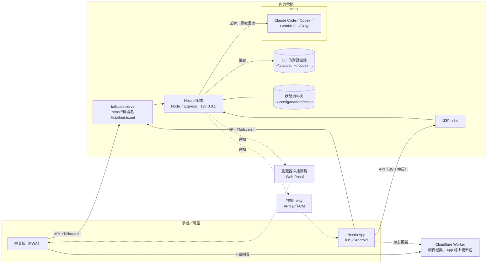
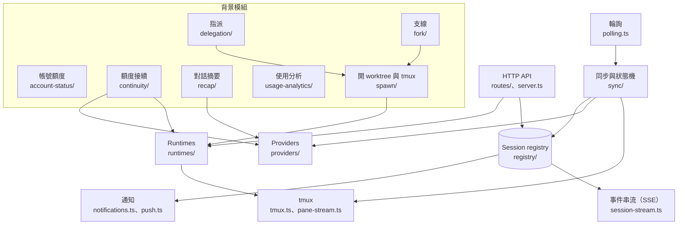

# 架構

- 更新：2026-10-20
- 英文版：[architecture.en.md](architecture.en.md)

給想了解或修改 Hestia 後端的人：各元件在哪裡、怎麼連、後端裡有哪些模組。功能介紹在 README；安裝見 [安裝說明](../guides/install.md)。

## 設計原則

- **只遙控官方 CLI。** Claude Code、Codex、Gemini CLI、Agy 都在 tmux 裡照常執行；後端只做三件事：把字送進 tmux、擷取畫面、讀 CLI 自己寫在磁碟上的對話紀錄。不讀 token 或 credential（唯一例外：Claude 憑證檔裡只讀登入到期時間一個欄位，見[帳號狀態](account-status.md)），也不直接呼叫廠商的私有 API。背景整理（對話摘要）同樣透過 CLI 官方的非互動模式（`claude -p`、`codex exec`）。
- **後端只在你自己的電腦上。** 只聽 `127.0.0.1`，其他裝置透過 Tailscale 或 App 的 SSH 連線進來。前端不內建任何後端。
- **tmux 是正本。** 後端重啟、升級都不會中斷 CLI；回到電腦前 `tmux -L hestia attach`（或 `hestia open`）就是同一個畫面。Hestia 的工作階段開在自己的 tmux server（`-L hestia`，名稱跟著工作階段前綴），不和你平常用的 tmux 混在一起：在一般終端機執行 `tmux kill-server` 不會關掉它們，同一台電腦上的兩套安裝也各用各的。這個 server 在後端服務之外：Linux 上由 `systemd-run --user --scope` 啟動，macOS 上 tmux 自成一個工作階段、LaunchAgent 也設了 `AbandonProcessGroup`，重啟或停止後端都不會牽連它。
- **個人使用。** 一台主機給一個人用；一個前端可以連多台主機。

## 元件與連線



| 元件 | 位置 | 做什麼 |
|---|---|---|
| 後端 `api/` | 你的電腦，使用者服務（Linux 與 WSL 是 systemd，macOS 是 launchd 的 LaunchAgent） | 管理 tmux 工作階段、把輸入送進 CLI、把對話紀錄整理成訊息、即時串流終端機畫面、推播通知，以及下面「後端模組」列的背景工作 |
| tmux 與 AI CLI | 同一台電腦 | 真正在執行的程式。後端只是遙控它們 |
| 網頁版與 App | 手機、電腦 | 同一份 Vue 3 前端；App 用 Capacitor 包成 iOS／Android。每台主機用自己的網址直連 |
| Cloudflare Worker | 營運方 | 只提供網頁檔案與 App 的線上更新包，不轉送 API |
| 推播 relay | 營運方 | 只給 App 用：把後端送來的通知轉給 APNs／FCM |

### 連線方式

只有兩種，沒有其他支援的方式：

- **Tailscale**：`tailscale serve` 提供 `ts.net` 網址與 HTTPS 憑證，轉到 `127.0.0.1` 上的後端，只有自己 tailnet 裡的裝置連得到。網頁版和 App 都能用。安裝程式可以不用 root 自動設定。
- **SSH（只有 App）**：App 用金鑰登入你自己的 sshd，再轉送到 `127.0.0.1`。不用裝 Tailscale；網頁做不到。

細節見 [多主機設計](multi-host-design.md)。

### 認證

- **登入**：帳號密碼，或掃 `hestia pair` 印出的 QR code（一次性配對碼，3 分鐘內有效），換到一個 bearer token，只放在 header。
- **即時串流**：EventSource 不能帶 header，所以改用 60 秒、只能用一次的 ticket。
- **圖片**：只能讀上傳檔的短效 media token。
- **本機工具 token**：後端啟動時寫在狀態資料夾，給這台電腦上的 `hestia` 指令用（包含 tmux 裡的 CLI）。需要使用者自己決定的操作，例如修改額度接續的設定，只收登入 token，不收這個。
- **CORS**：預設只接受 Hestia App；自己架網頁前端時，安裝時用 `--cors-origins` 設定。

### 推播

- **網頁版**：Web Push。VAPID 金鑰在第一次使用時產生，存在狀態資料夾，只有這個使用者讀得到。
- **App**：iOS／Android 不能用 Web Push。App 訂閱時告訴後端 relay 的網址和一組不透明的憑證，後端每次通知都帶著它送過去；後端本身不知道任何 relay。

### 相容性

前端新增主機時會讀 `GET /meta`：API 合約版本（`contractVersion`）相同才使用，再依 `capabilities` 決定要顯示哪些功能。合約見 [API 合約 v1](api-contract-v1.md)。

## 後端模組



| 模組 | 位置 | 做什麼 |
|---|---|---|
| HTTP API | `server.ts`、`routes/` | Express，路徑都在 `/api` 下；除了登入與健康檢查（`/api/health`），都要先驗證 |
| 共用合約 | `contract/` | 前後端共用的型別、錯誤碼與 `/meta` 的內容 |
| 工作階段 registry | `registry/`、`registry.json` | 每個 tmux 工作階段、它屬於哪個專案、裡面先後跑過的每一段對話 |
| tmux | `tmux.ts`、`pane-stream.ts` | 開關 tmux、送字、擷取畫面、即時串流終端機；每個工作階段的指令送到它所在的 tmux server（`registry.tmuxSocketFor`） |
| Runtimes | `runtimes/` | 每種 CLI 怎麼啟動、恢復、切換 model、`/clear`，以及回答啟動時的確認畫面（例如信任資料夾） |
| Providers | `providers/` | 讀每種 CLI 自己的對話紀錄（Claude、Codex 的 JSONL，Agy 的 SQLite），也判斷是否撞到額度上限 |
| 輪詢、同步與狀態機 | `polling.ts`、`sync/` | 定時對照每個工作階段的畫面、程序與對話紀錄，判斷「回覆中／可輸入／需要處理」，確認送出的訊息真的送到。狀態機的設計見 [ADR 0007](../decisions/0007-session-state-machine.md)、[ADR 0010](../decisions/0010-runtime-transition-convergence.md) |
| 事件串流 | `session-stream.ts`、`routes/events.ts` | 用 SSE 把工作階段的變化推給前端 |
| 通知 | `notifications.ts`、`push.ts` | 回覆完成或等你確認時推播 |
| Launch profile | `launch-profiles.ts` | 一個「CLI＋帳號＋參數」的組合，用來啟動工作階段、交接時換帳號 |
| 帳號額度 | `account-status/` | 每 15 分鐘查一次各帳號的 5 小時／7 天額度，寫成快照，前端只讀快照。見 [帳號額度](account-status.md) |
| 額度接續 | `continuity/` | 撞到額度上限時，記下重置時間、時間到自動繼續；或交接給 chain 裡的下一個 profile（同一個 tmux、新的對話，先確認接手的 CLI 理解了才開始）。目前支援 Claude Code 與 Codex |
| 對話摘要 | `recap/` | 預設關閉。開啟後，每段對話在閒置時分批交給 CLI 的非互動模式整理成摘要 |
| 使用分析 | `usage-analytics/` | 每分鐘掃一次 CLI 的紀錄，把 token 用量存進本機 SQLite |
| 指派 | `delegation/` | 早期功能：把一件工作交給另一個 profile，在新的 tmux 與 git worktree 裡執行，交付後由使用者驗收 |
| 支線 | `fork/` | 早期功能：從一個對話另開一條線，在新的 tmux 與 git worktree 裡帶著它的記憶同時進行（同一個 profile 用 CLI 原生的 fork，其他寫一份說明檔）；不回報、不交付，只記錄從哪裡分出來 |
| 開 worktree 與 tmux | `spawn/` | 指派與支線共用的核心：規劃與建立 worktree、建 tmux、啟動 CLI、送出說明並讀回驗證，收尾時檢查 branch 是否已合併 |
| 檔案與 Git | `fs-browser.ts`、`repo-*.ts`、`git/` | 瀏覽專案檔案、Git 狀態、歷史與差異 |
| 便箋、專案、標籤 | `notes/`、`notes-store.ts`、`project-store.ts`、`tag-index.ts` | 便箋與附圖、專案清單、標籤索引 |
| 可選模組 | `module-host/`、`api/modules/*` | 啟動時載入 `api/modules/` 底下的可選模組：掛上它的路由（同樣要先驗證），在 `/meta` 的 `modules` 與 `capabilities` 列出。沒有任何模組時照常啟動；公開版不含可選模組 |
| `hestia` 指令 | `cli/` | `hestia pair`（配對新裝置）、`hestia conversation show`（把一段對話印成 markdown，不存檔）等；連這台電腦上的後端 |

## 狀態資料夾

預設是 `~/.config/madera/hestia/`（有設定 Tessera 家族的 `MADERA_HOME` 時放在它底下，否則有 `XDG_CONFIG_HOME` 時跟著它）。升級、重新安裝都會保留。主要內容：

| 檔案 | 內容 |
|---|---|
| `registry.json` | 工作階段、對話段落 |
| `session-events.jsonl` | 每個 tmux 發生過什麼：誰關閉、刪除、重新啟動，什麼時候被發現 tmux 不見了（一行一筆，超過 2MB 換成 `.1`） |
| `projects.json`、`notes/`、`uploads/` | 專案、便箋、上傳的檔案 |
| `launch-profiles.json` | launch profile |
| `session-tokens.json`、`cli-token` | 登入 token、本機工具 token |
| `vapid.json`、`push-subscriptions.json` | Web Push 金鑰、各裝置的推播訂閱 |
| `account-status.json` | 帳號額度快照 |
| `continuity.json`、`delegation.json`、`fork.json`、`conversation-recap.json` | 額度接續、指派、支線、對話摘要的設定與進度 |
| `usage-analytics/` | 使用分析的 SQLite |

含有 token 或金鑰的檔案權限都是只有這個使用者能讀。

## 專案結構

```
install.sh  一行安裝／升級：下載 Release 的版本包，再交給 api/scripts/install.sh
api/
  src/      後端；src/contract 是前後端共用的 API 合約，src/module-host 載入可選模組
  modules/  可選模組，啟動時載入（公開版沒有這個資料夾）
  test/     測試（Vitest）
  scripts/  install.sh 安裝腳本等
docs/       安裝說明、參考文件與公開的設計決策
```

開發：`cd api && npm ci && npm test`。程式依賴各 CLI 的畫面與檔案格式，對齊的版本記在 [CLI 版本對齊](cli-version-alignment.md)。

### 登入與串流的撤銷生命週期

`auth.ts` 以 token 的 SHA-256 索引登入，儲存建立與最後使用時間，套用 90 天最長期限與 30 天閒置期限。`auth_sessions` API 只給同帳號的使用者登入管理權，使用另一層雜湊的公開 ID；本機工具 token 不可管理登入。

stream ticket 記住父登入的 digest，兌換後把身分保存在 request WeakMap。`openSse` 每次事件與 heartbeat 檢查父登入，撤銷登記的 callback 立即結束回應；CLI 憑證輪替也會結束其串流與票券。撤銷先從記憶體移除登入，再等待原子檔案寫入；失敗回錯誤並保留可重試的待寫入紀錄，匿名登出不能觸發磁碟寫入。

測試必須從各 package 執行。根目錄 `vitest.config.mjs` 直接拒絕測試探索，避免執行封存版本中沒有隔離狀態目錄的測試；API 使用自己的 setup file 指向暫存目錄。
